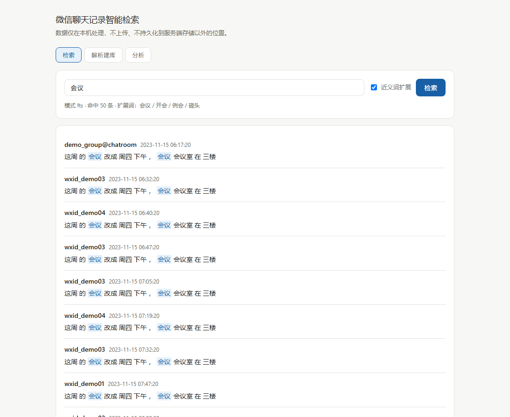

# We_Chat_MSG — 微信聊天记录智能检索

把微信导出的聊天记录数据库变成一个**可检索、可分析、可问答**的本地服务：
FastAPI 提供 REST + SSE 接口，SQLite FTS5 做全文索引，jieba 分词 + 近义词表做多路召回，Vue 3 单页前端。

> 隐私约定：聊天记录属于高敏感个人信息。本项目**只做本机处理**，数据不上传；
> 演示数据用 `tools/make_demo_db.py` 生成的伪造样本，真实数据库文件已加入 `.gitignore`，绝不入库。



---

## 三步跑起来

```bash
# 1. 安装后端依赖（Python 3.11+）
python -m venv .venv
.venv/Scripts/pip install -r requirements.txt     # Linux/macOS: .venv/bin/pip

# 2. 前端构建（推荐，需要 Node 18+；跳过则自动回退到 web/ 单文件版）
cd frontend && npm install && npm run build && cd ..

# 3. 准备数据（二选一）
.venv/Scripts/python -m tools.make_demo_db --rows 20000   # 生成脱敏演示库
# 或把微信导出的 de_MSG0.db 放到 data/ 下（结构对齐 PyWxDump 导出的 MSG 表）

# 4. 建索引 + 启动
.venv/Scripts/python -m app.cli pipeline
.venv/Scripts/python -m app.cli serve          # 打开 http://127.0.0.1:8000
```

也可以直接指定数据库：`python -m app.cli --db D:/path/de_MSG0.db pipeline`，
或设置环境变量 `WCM_DB_PATH`（见 `.env.example`）。

### 前端开发模式

```bash
cd frontend
npm run dev        # http://localhost:5173，/api 自动代理到 127.0.0.1:8000
```

改代码热更新（HMR）；`npm run build` 产物输出到 `frontend/dist`，由 FastAPI 直接托管。
后端优先用 `frontend/dist`，不存在时回退 `web/` 的单文件版（`/api/health` 的
`frontend` 字段标识当前用的是哪套）。

## 功能一览

| 入口 | 说明 |
|---|---|
| `GET /api/search?q=词` | 全文检索，支持近义词扩展（`expand=0` 关闭）、`mode=fts/like` |
| `POST /api/tasks` + `GET /api/tasks/{id}` | 长任务（分词/关键词/索引）异步提交 + 轮询进度 |
| `GET /api/analyze` | SSE 流式返回本地统计摘要（LLM 接入点已预留） |
| `GET /api/stats` | 消息数、待处理数、索引行数 |
| CLI | `python -m app.cli stats / pipeline / segment / keywords / index / search 词 / serve` |

旧的三个脚本（`提取词模型.py`、`总结关键词模型.py`、`近义词模型.py`）保留为兼容入口，
内部直接调用 `app.services`，不再有各自的逻辑副本。

## 架构

```
app/
├── api/          # FastAPI 路由：search / tasks / analyze(SSE)
├── services/     # 业务层（纯函数，不碰 UI / 不碰 HTTP）
│   ├── ingest.py     # 分词 → 关键词 → FTS 索引，增量 + 批量
│   ├── segment.py    # jieba 分词（索引用 search 模式）+ TF-IDF 关键词
│   ├── search.py     # FTS5 MATCH / LIKE 回退，近义词多路召回
│   ├── synonyms.py   # 纯文本近义词表（替代停更的 synonyms 包）
│   └── analyze.py    # 本地统计式摘要（流式生成）
├── db/           # schema.sql（FTS5 + 触发器）+ repo.py（全部参数化 SQL）
├── core/         # 配置（pydantic-settings，.env）+ 日志
└── cli.py        # 命令行入口
frontend/         # Vite + Vue 3 SFC
└── src/
    ├── components/   # SearchView / IngestView / AnalyzeView
    ├── composables/  # useSearch（可取消）/ useTaskPolling（指数退避）/ useSSE
    ├── api/          # fetch 封装，错误归一化 + AbortSignal
    └── utils/        # 高亮渲染（转义 → 哨兵还原）
web/              # 重构前的单文件版（未构建时的兜底）
tests/            # pytest：分词 / 增量 / 检索 / SQL 注入 / API / SSE
tools/            # 演示数据生成 + 性能压测
```

分层原则：`services` 层不出现任何 UI 代码，CLI / Web / 旧脚本共用同一套逻辑。

## 性能实测

`python -m tools.benchmark --sizes 20000,100000 --runs 10`（伪造数据，命中密集场景）：

| 数据量 | LIKE 全量匹配 P50 | FTS 全量匹配 P50 | FTS 取前50（按需早停） |
|---|---|---|---|
| 20,000 行 | 5.9 ms | 0.08 ms | 0.34 ms |
| 100,000 行 | 30.6 ms | 0.44 ms | 0.34 ms |

两个值得注意的结论（也是面试可以讲的点）：

1. **全量匹配**：LIKE 随数据量线性变慢，FTS 快约 70 倍且绝对值稳定在毫秒内；
2. **取前 50 条**：LIKE 有 LIMIT 早停的假象（命中密集时恰好很快）；
   FTS 若默认按 `bm25` 排序，要对全部命中算分排序，命中上万条时反而慢——
   所以实现了 `ranked=False` 的早停路径，按需取舍。

## 设计要点

- **增量**：按 `segmented_content IS NULL` 驱动，重跑只处理新消息（旧实现列存在就整段跳过）；
- **批量**：`rowid` 定位 + `executemany` + 分批事务（旧实现按 StrTalker+StrContent 逐行更新，N² 全表扫描）;
- **安全**：SQL 全部参数化；FTS5 查询串对词做引号包裹 + 操作符字符清洗，用户输入进不了查询语法；
- **索引同步**：FTS5 虚表 + AFTER INSERT/UPDATE/DELETE 触发器，`app.cli index` 可全量重建兜底；
- **长任务**：解析不能塞在一个 HTTP 请求里跑，任务表 + 进度回调 + 轮询，接口契约不变的前提下可平滑换 Redis；
- **前端**：SFC + composables 分层；检索请求带 AbortController + 序号守卫（迟到响应直接丢弃）；
  轮询按指数退避（800ms → 4s）且容忍瞬时失败；事件流断连由 EventSource 内置重连兜底。

## 测试

```bash
.venv/Scripts/python -m pytest        # 24 个用例：分词 / 增量 / 检索 / 注入 / API / SSE
```

## 路线图

- [x] P0 修硬伤：SQL 注入、无效近义条件、N² 更新、增量失效、异常兜底
- [x] P1 分层：services / db / core / api / cli，配置外置，requirements
- [x] P2 FTS5 索引 + 增量管道 + 压测基线
- [x] P3 Web：FastAPI 三接口 + 任务轮询 + SSE + Vue 3 单页
- [x] P3-b 前端工程化：Vite + SFC 拆分 + composables，构建产物由 FastAPI 托管（单文件版保留为兜底）
- [ ] P4 语义检索：bge-small-zh + FAISS 双路召回；LLM 摘要接入 `services/analyze.py` 预留点
- [ ] 图片检索：旧实验脚本待 CLIP 方案重做或移除

## legacy/

重构前的 Tkinter 桌面端骨架（`legacy/main.py`、`legacy/modules/`）与图片检索实验脚本
（`legacy/图片特征提取/`）。这些代码已被 `app/` 的新架构取代，仅作历史留存，不再维护。
其中图片实验用的本地测试图片不入库（见 `.gitignore`）。

## 参与贡献

1. Fork 本仓库
2. 新建 `Feat_xxx` 分支
3. 提交代码（确保 `pytest` 通过）
4. 新建 Pull Request
